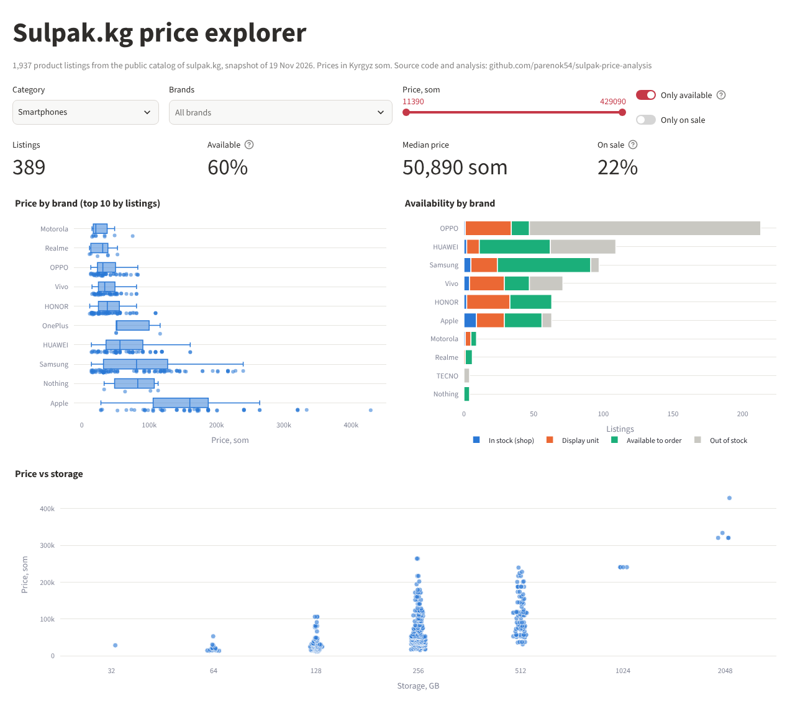
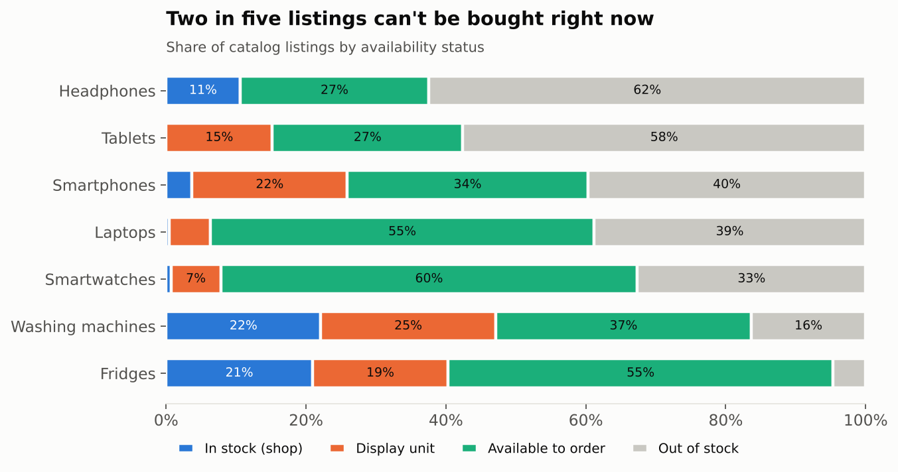
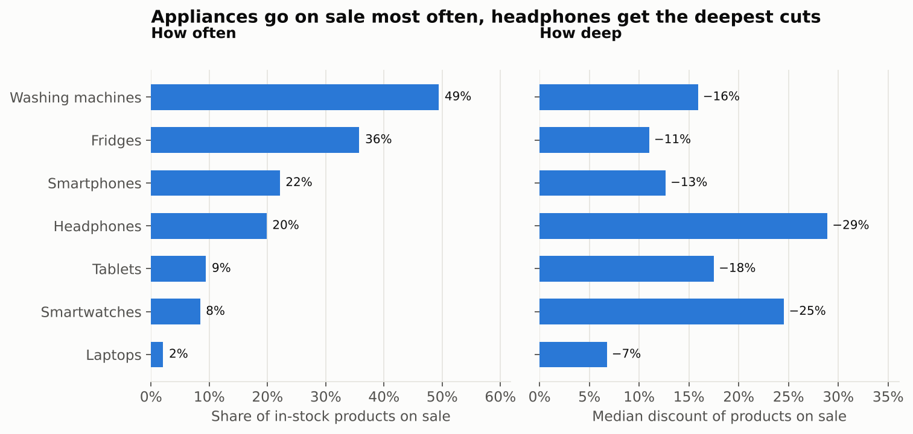
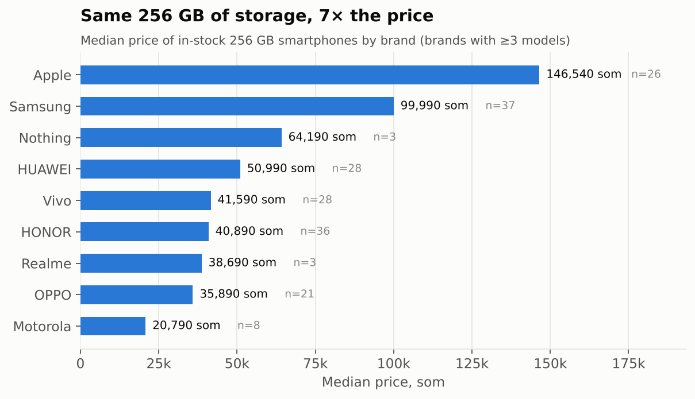
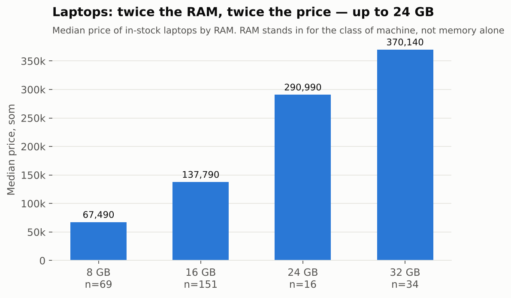
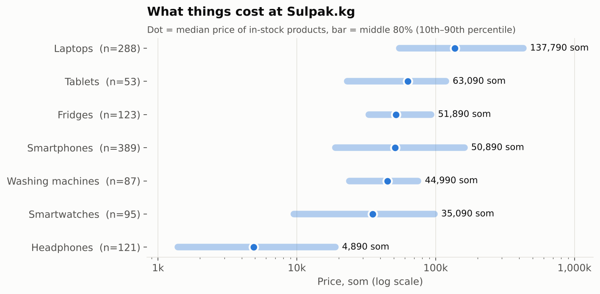

# Sulpak.kg price analysis

**What does Kyrgyzstan's biggest electronics retailer actually sell, at what prices, and where are the real discounts?**

A full data project: a scraper for the public catalog of [sulpak.kg](https://www.sulpak.kg), cleaning and feature extraction with pandas, an analysis notebook, and an interactive Streamlit dashboard.

[](https://sulpak-price-analysis.streamlit.app) **Live dashboard:** https://sulpak-price-analysis.streamlit.app

**Dataset:** 1,937 product listings, 7 categories (smartphones, laptops, headphones, tablets, smartwatches, fridges, washing machines), snapshot of **19 Nov 2026**.

<p align="center"></p>

## Key findings

| | |
|---|---|
| 📦 **40% of listings can't be bought.** Headphones are 62% out of stock, tablets 58%, while fridges are 95% available. All 277 promo "bundle" listings are out of stock: old promotions stay in the catalog after they end. |  |
| 🏷️ **Discounts are a category strategy.** Half of in-stock washing machines and a third of fridges are on sale; laptops almost never (2%). Headphones are discounted less often but deepest (median −29%). The biggest single saving: 112,900 som off a Haier fridge. |  |
| 📱 **Brand drives smartphone price more than specs.** For the same 256 GB of storage the median phone costs 20.8k som (Motorola), 36–42k (OPPO, HONOR, Vivo), 100k (Samsung) and 146.5k (Apple): a 7× spread. |  |
| 💻 **Laptop price doubles with each RAM tier up to 24 GB** (67k → 138k → 291k som). RAM stands in for the class of machine: office laptops have a median of 58k, gaming laptops and MacBooks both ~195k. |  |
| ⭐ **Star ratings carry no information:** 98.6% of reviewed products show 5 stars. Review *counts* do: the most reviewed products are a 19,890 som ARG washing machine (1,814 reviews) and the iPhone 15 and 14, not flagships. |  |

Full analysis with tables: [`notebooks/analysis.ipynb`](notebooks/analysis.ipynb).

## Project structure

```
scraper/sulpak_scraper.py   # requests + BeautifulSoup scraper -> CSV
src/clean.py                # cleaning, availability rules, spec parsing (RAM, storage, battery, volume, ...)
src/charts.py               # static charts used in the notebook and README
notebooks/analysis.ipynb    # the analysis, executed, with outputs
app.py                      # Streamlit dashboard
data/raw/                   # raw scrape (JSON)
data/sulpak_clean.csv       # analysis-ready table, 33 columns
tests/                      # pytest: parser on a saved catalog page, cleaning rules
```

## How it works

**Scraping.** The public category pages (`/f/<category>?page=N`) stop after ~8 pages (~176 products) and then repeat the last page. The site's own "show more" button loads products from `/Filter/LoadProducts`, which returns JSON with the product cards as HTML plus a paginator holding the real page count, so the scraper reads that endpoint instead. It requests one page at a time with a pause (1 s by default). Both paths are allowed by the site's `robots.txt`.

**Cleaning rules** found while exploring the data:
- `data-price="0"` marks an **out-of-stock** listing. These are kept and flagged, not dropped (781 listings).
- A priced card without an availability label can be ordered online: *Available to order*.
- 0 stars on a card means *no reviews yet*, not a 0-star rating.
- Listings starting with "Комплект" are shop bundles (phone + gift) and are flagged separately.
- Cards without a brand attribute get the brand from the product name.

## Run it

```bash
pip install -r requirements.txt

python scraper/sulpak_scraper.py -o data/raw/my_run.csv       # fresh scrape (~3 min)
python src/clean.py data/raw/my_run.csv data/sulpak_clean.csv  # clean
streamlit run app.py                                           # dashboard at http://localhost:8501
pytest                                                         # tests
```

## Limitations

One-day snapshot, so no price history; the card shows one price per product (the listed configuration); spec lines on cards are short, so some features are missing for some products; brand medians with few models (n < 5) are indicative only.

**Next steps:** schedule the scraper daily to track price changes and check whether "old prices" are real, and scrape product pages for full specs.

---
Made by [Baiastan (Basik)](https://github.com/parenok54). Unofficial project, not affiliated with Sulpak. Data is collected from publicly available catalog pages for analysis.
